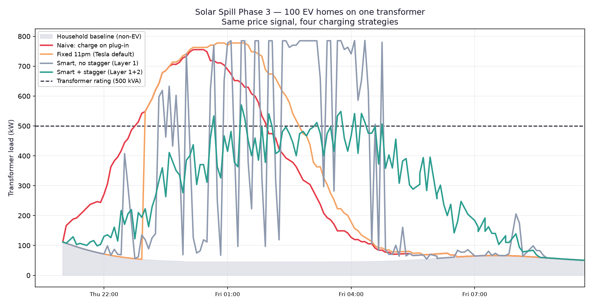
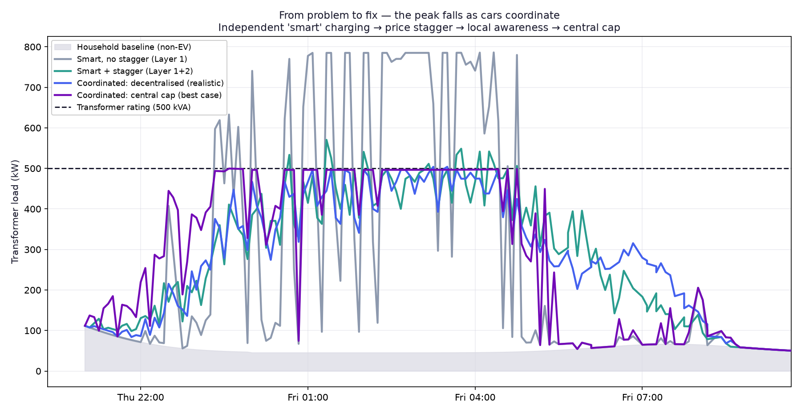

# Solar Spill

**A simulation of EV charging on a shared suburban transformer, built on real Queensland grid data, comparing six charging strategies. With a physical ESP32 demonstrator driven by live AEMO prices.**

> Every car independently charging in its own cheapest hours is the **worst** strategy tested: all 100 cars switch on in the same five-minute interval, peaking at **157% of the transformer's rating with 42 overloaded intervals**. That is worse than a dumb 11pm timer. Capacity-aware coordination brings the peak to **99.9% with zero overloads, every car still charged by its deadline**, for about 17 cents more per car per night.



---

## The result

100 EV homes on one shared 500 kVA distribution transformer, replaying 352 five-minute intervals of real QLD spot price and demand captured 2 to 4 July 2026.

| Strategy | Peak load (% of rating) | Overloaded intervals | Coincidence factor | Avg wholesale cost per car | Deadlines met |
|---|---|---|---|---|---|
| Charge on plug-in | 151% | 38 | 0.96 | $1.86 | 100% |
| Fixed 11pm timer | 156% | 45 | 0.99 | $1.79 | 100% |
| **Smart, uncoordinated** (each car picks its cheapest hours) | **157%** | 42 | **1.00** | $1.60 | 100% |
| Smart + stochastic staggering | 114% | 11 | 0.71 | $1.86 | 100% |
| Smart + decentralised local-load awareness | 101% | 2 | 0.62 | $1.87 | 100% |
| **Smart + capacity-aware central allocation** | **99.9%** | **0** | 0.61 | $1.78 | 100% |

Full method and discussion in [`PHASE3.md`](PHASE3.md). Raw results in [`phase3_out/summary.csv`](phase3_out/summary.csv).

**What the table says:**

- **Individually optimal is collectively worst.** A coincidence factor of 1.00 means every car charges in the same interval. Each car making the "smart" choice produces a sharper spike than doing nothing clever at all, because they all compute the same answer from the same price feed.
- **Staggering on a statewide signal is not enough.** Randomised start times cut the peak to 114% but still left 11 overloads, because statewide price and demand say nothing about one street's transformer.
- **Only local-capacity awareness clears it.** The capacity-aware allocator hands out charging slots cheapest-first but never beyond what the transformer can carry.
- **Coordination is cheap.** The capacity-aware strategy costs $0.17 more per car per night than selfish smart charging, and is still cheaper than charging on plug-in.



---

## Why this matters

A price signal coordinates behaviour. It does not create physical headroom. Cheap power statewide does not mean one street's transformer can deliver it to every house at once.

Individual smart charging is already a commodity: retailer time-of-use tariffs, Amber's price-following, and every EV's built-in scheduler do it. Charge HQ, Australia's best-known standalone smart charging app, closed in September 2026 as the feature was absorbed by retailers.

What those tools do not solve is many households responding to the *same* cheap signal at the *same* instant. Energex's EV SmartCharge Queensland trial observed exactly this: when one retailer's cheap rate began at a fixed hour, around 13% of participants started charging at that moment. Energex designs its LV network for roughly 3 to 4 kW per house at peak; a single 7 kW charger is a large step up.

---

## Findings that shaped the design

**Smart timing barely saves the driver money.** On the captured data, uncoordinated smart charging cost $1.60 per car per night on the wholesale component versus $1.86 for charging on plug-in: about 26 cents. On a flat Queensland retail tariff, the most common kind, it saves nothing at all. If the individual saving is that small, the value has to be somewhere else. That is why this project is about network coordination, not consumer savings.

**Any shared threshold recreates the spike.** "Charge at 11pm" moves the spike to 11pm. "Charge under $50/MWh" switches every charger on the moment the price crosses the line. Both dead ends are documented in [`DECISIONS.md`](DECISIONS.md).

**Statewide signals are blind to the local transformer.** Two neighbours can both pick a "healthy" interval and stack on the same street. See [`phase3_out/signal_vs_local.png`](phase3_out/signal_vs_local.png).

**Home batteries do not fix this.** With 50% of homes carrying a 10 kWh battery, the overnight EV peak is unchanged. A battery shaves its own household's load; it does not talk to the house next door. See [`phase3_out/battery_scenario.png`](phase3_out/battery_scenario.png).

**The cheap window is midday, not overnight.** Queensland's solar oversupply produced negative prices down to -$2.50/MWh in the capture. A car on an overnight timer misses this entirely.

---

## What's built

```
AEMO ELEC_NEM_SUMMARY  (live 5-minute QLD price and demand)
        |
        v
  price_check.py --> decision.py --> scheduler_planner.py
   live fetch        charge/wait +    deadline-aware
                     1-10 dispatch    interval selection
                     weight                 |
        |                                   v
  qld_decisions.csv                   simulation.py
   352-interval capture               100 homes, 500 kVA,
                                      six strategies
        |
        v
    server.py --> Flask /decision --> ESP32-S3 over Wi-Fi --> LEDs
```

**1. Data pipeline.** `price_check.py` and `logger.py` poll AEMO every five minutes and log to CSV with dropout handling. `graph.py` plots price against demand.

**2. Decision engine.** `decision.py` turns each reading into a charge/wait call and a 1 to 10 dispatch weight (a 60/40 blend of price and demand). Every threshold is justified in [`DECISIONS.md`](DECISIONS.md). `scheduler_planner.py` selects the cheapest intervals that still meet a charging deadline.

**3. Simulation.** `simulation.py` runs 100 homes on one transformer through six strategies, each car running the Phase 2 planner, and reports peak load, coincidence factor, overloads, cost and deadline compliance.

**4. Physical demonstrator.** `server.py` serves the live decision as JSON from a Flask endpoint, with a cache so AEMO is called once per settlement interval. An ESP32-S3 polls it over Wi-Fi and drives an LED that switches with the live Queensland grid. A ten-LED board representing ten houses on one transformer is wired and verified. Sketches in [`esp32/`](esp32/), hardware notes in [`HARDWARE.md`](HARDWARE.md).

---

## Scope, honestly

This is a simulation and a demonstrator, not a deployable controller.

- **The per-car planner assumes known prices.** That is valid for replaying captured historical data and gives a best-case benchmark. A live system would need AEMO forecasts plus an override when a deadline gets close.
- **One dataset.** About 38 hours of Queensland winter data. Results should be checked across seasons before being generalised.
- **Energex already manages EV chargers.** Under QECM v4, Energex sends dynamic operating envelopes to chargers on dynamic connections. This project does not replace that. It asks a narrower question: given a capacity limit, which allocation strategy keeps everyone's deadline?
- **Not connected to real chargers.** That would need OCPP integration and network approval, which are out of scope.

---

## Running it

```bash
git clone https://github.com/SSV227/solar-spill.git
cd solar-spill
python3 -m venv venv
source venv/bin/activate
pip install -r requirements.txt

python price_check.py     # one live AEMO reading
python decision.py        # decision engine self-test
python simulation.py      # full simulation, writes plots to phase3_out/
python server.py          # Flask endpoint for the ESP32, port 5001
```

The ESP32 sketch needs a `secrets.h` with your Wi-Fi details (copy `secrets.h.example`) and the ArduinoJson library from the Arduino Library Manager.

---

## Next

- Add a uniform-cap strategy that models how dynamic operating envelopes throttle chargers today, as a deployed-practice baseline
- Fairness metrics: who waits longest, and is it always the same households
- EV penetration sweep: the adoption level at which each strategy first overloads
- Replace the known-price planner with a forecast and urgency override
- Ten-LED demonstrator switching between uncoordinated and coordinated modes

---

Built by Sritam Vytla, Electrical Engineering (Honours) and Computer Science, University of Queensland, from June 2026.
